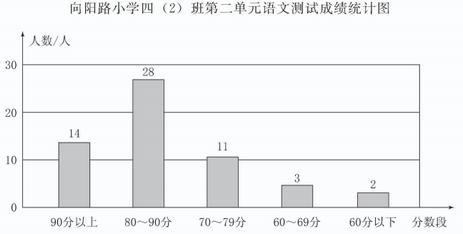

# Mathematics (Grade 6)

**ID**: 42908fc7
**难度**: hard
**题型**: fill_in_the_blank

## 题目
下面是向阳小学四（2）班第二单元语文测试成绩统计图。

1.四（2）班一共有（）人。
2.（）成绩段的人数最多，有（）人。
3.（）成绩段的人数最少，有（）人。
4.你认为他们这次的成绩怎么样？谈谈你的看法。

## 解答

**答案**: 58, 80～90分, 28, 60分以下, 2

1. Step1:观察统计图，确定90分以上有14人，80 - 90分有28人，70 - 79分有11人，60 - 69分有3人，60分以下有2人
2. Step2:计算四（2）班总人数，14 + 28 + 11 + 3 + 2 = 58人
3. Step3:比较各分数段人数，得出80～90分成绩段人数最多，为28人
4. Step4:比较各分数段人数，得出60分以下成绩段人数最少，为2人

## 知识点

**知识点**:
  - 单式条形统计图

---
