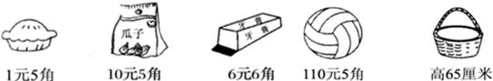

# Mathematics (Grade 6)

**ID**: 478f5867
**难度**: hard
**题型**: fill_in_the_blank

## 题目
填上合适的小数．

$\underline{\hspace{5em}}$；$\underline{\hspace{5em}}$；$\underline{\hspace{5em}}$；$\underline{\hspace{5em}}$；$\underline{\hspace{5em}}$．

## 解答

**答案**: 1.5元, 10.5元, 6.6元, 110.5元, 6.5分米或0.65米

1. Step1:对于1元5角，将5角除以进率10得到0.5元，再与1元相加，得出1.5元
2. Step2:对于10元5角，把5角除以10得0.5元，与10元相加，得到10.5元
3. Step3:对于6元6角，将6角除以10得0.6元，和6元相加，得出6.6元
4. Step4:对于110元5角，把5角除以10得0.5元，与110元相加，得到110.5元
5. Step5:对于65厘米，除以进率10得到6.5分米，除以进率100得到0.65米

## 知识点

**知识点**:
  - 货币、人民币的单位换算；小数大小的比较．

---
