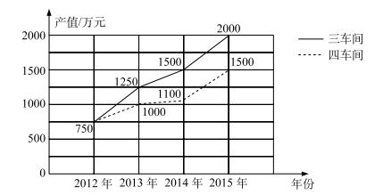

# Mathematics (Grade 6)

**ID**: 4b374264
**难度**: hard
**题型**: fill_in_the_blank

## 题目
下面是某纺织厂2012~2015年三、四车间工业产值增长情况统计图。

（1）（）车间的工业产值增长较快。
（2）（）年两车间的工业产值相差最大。
（3）四车间2015年的工业产值比2014年增长几分之几？

## 解答

**答案**: 三, 2015, 4/11

1. Step1:观察统计图，三车间的折线更陡，根据折线统计图中折线越陡增长越快，可知三车间的工业产值增长较快，所以第一空答案为三
2. Step2:观察统计图中每年两车间折线点的高度差，2015年两车间折线点高度差最大，即两车间产值相差最大，所以第二空答案为2015
3. Step3:四车间2015年工业产值为1500万元，2014年为1100万元，先计算产值增长的数值为1500 - 1100 = 400万元，再用增长的数值除以2014年的产值，即400÷1100 = 4/11，所以第三空答案为4/11

## 知识点

**知识点**:
  - 

---
