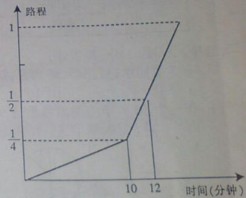

# Mathematics (Grade 6)

**ID**: 4bff36e9
**难度**: hard
**题型**: fill_in_the_blank

## 题目
田叔叔从家出发，步行前往单位上班，10分钟走了全程的
 $\frac{1}{4}$
  ，田叔叔估计不能准时到达，于是改乘出租车前往单位，他的行程与时间关系如图所示（假定总路程为1）．
 （1）如果田叔叔步行上班，走完全程需要（    ）分钟．
 （2）从全程的
 $\frac{1}{4}$
  处到全程的
  $\frac{1}{2}$
   处，出租车行驶了（    ）分钟，由此推算如果田叔叔全程都坐出租车，（    ）分钟就可以从家到达单位．
 （3）按题中“先步行、再坐车”的交通方式，田叔叔上班途中一共要花（    ）分钟，比全程步行要提前（    ）分钟到达单位．

## 解答

**答案**: 40, 2, 8, 16, 24

1. Step1:计算步行速度，根据10分钟走了全程的$rac{1}{4}$，速度 = 路程÷时间，即$rac{1}{4}÷10=rac{1}{40}$
2. Step2:计算步行走完全程所需时间，时间 = 路程÷速度，全程为1，所以时间为$1÷rac{1}{40}=40$分钟
3. Step3:计算从全程的$rac{1}{4}$处到全程的$rac{1}{2}$处出租车行驶时间，由图可知为12 - 10 = 2分钟
4. Step4:计算出租车速度，从全程的$rac{1}{4}$处到全程的$rac{1}{2}$处，路程为$rac{1}{2}-rac{1}{4}=rac{1}{4}$，时间为2分钟，速度 = 路程÷时间，即$rac{1}{4}÷2=rac{1}{8}$
5. Step5:计算全程坐出租车所需时间，时间 = 路程÷速度，全程为1，所以时间为$1÷rac{1}{8}=8$分钟
6. Step6:计算先步行再坐车上班途中花费总时间，步行10分钟，坐车路程为$1 - rac{1}{4}=rac{3}{4}$，坐车时间 = 路程÷速度，即$rac{3}{4}÷rac{1}{8}=6$分钟，总时间为10 + 6 = 16分钟
7. Step7:计算比全程步行提前的时间，全程步行40分钟，先步行再坐车16分钟，提前时间为40 - 16 = 24分钟

## 知识点

**知识点**:
  - --

---
