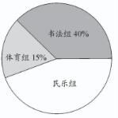

# Mathematics (Grade 6)

**ID**: 4d16684e
**难度**: hard
**题型**: fill_in_the_blank

## 题目
某班参加兴趣小组的情况如下：

（1）参加民乐组的占（）%。
（2）（）组所占的百分比最少。
（3）如果全班有40人，那么书法组有（）人，体育组有（）人，民乐组有（）人。
（4）你还能提出哪些问题？

## 解答

**答案**: 45, 体育组, 16, 6, 18, 书法组比体育组多10人

1. Step1:计算民乐组所占百分比，用1减去体育组占的15%和书法组占的40%，即1 - 40% - 15% = 45%
2. Step2:比较三个组所占百分比大小，45%＞40%＞15%，得出体育组所占百分比最少
3. Step3:计算书法组人数，全班40人，书法组占40%，则人数为40×40% = 16人
4. Step4:计算体育组人数，全班40人，体育组占15%，则人数为40×15% = 6人
5. Step5:计算民乐组人数，全班40人，民乐组占45%，则人数为40×45% = 18人
6. Step6:提出问题“书法组比体育组多多少人”，并计算16 - 6 = 10人

## 知识点

**知识点**:
  - 百分数应用题;扇形统计图的认识及绘制

---
