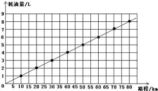

# Mathematics (Grade 6)

**ID**: 4d245653
**难度**: hard
**题型**: fill_in_the_blank

## 题目
王叔叔买了一辆新汽车，下图表示的是他从A地开往B地行驶的路程与耗油量之间的关系．

（1）行驶的路程和耗油量成$\underline{\hspace{5em}}$比例；
（2）A地到B地有65km，汽车耗油$\underline{\hspace{5em}}$升；
（3）王叔叔到B地后，还要去C地，B地距C地55km，此时油箱中大约有4升汽油，他需要加油吗？$\underline{\hspace{5em}}$（填“需要”或“不需要”）．

## 解答

**答案**: 正, 6.5, 需要

1. Step1:观察图表，发现表中有行驶的路程和耗油量这两种相关联的量，耗油量随行驶路程变化而变化，且10÷1=10、20÷2=10、30÷3=10、40÷4=10，耗油量与行驶路程的比值一定，根据正比例关系式x：y=k（一定），得出行驶的路程和耗油量成正比例
2. Step2:已知x：y=10，A地到B地有65km，即x = 65，那么y = 65÷10 = 6.5，所以汽车耗油6.5升
3. Step3:B地距C地55km，因为x：y=10，此时x = 55，则y = 55÷10 = 5.5升，又因为油箱中大约有4升汽油，5.5＞4，所以他需要加油

## 知识点

**知识点**:
  - 单式折线统计图；从统计图表中获取信息．

---
