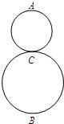

# Mathematics (Grade 6)

**ID**: 4d798b95
**难度**: hard
**题型**: fill_in_the_blank

## 题目
有两条圆形跑道，它们有一个交点C．甲、乙分别在AB两点，沿着数字“8”的书写方向跑步．如图的小圈跑道长200米，如图的大圈跑道长300米，如果甲和乙的速度分别是每秒钟2米和3米，那么当两个人第一次同时回到出发点的时候，他们已经相遇了$\underline{\hspace{5em}}$次；（只要两个人在同一地点就算相遇）

## 解答

**答案**: 2

1. Step1:计算乙与甲的相对速度，3 - 2 = 1（米/秒）
2. Step2:计算当两个人第一次同时回到出发点时，乙相对于甲的路程，为大圆跑道长与小圆跑道长之和，即 300 + 200 = 500（米）
3. Step3:根据“时间 = 路程÷速度”，计算两个人第一次同时回到出发点所用的时间，500÷1 = 500（秒）
4. Step4:计算第一次相遇时，乙相对于甲的路程，为大圆一半与小圆一半的长度之和，即(300 + 200)÷2 = 250（米）
5. Step5:计算第一次相遇时所用的时间，250÷1 = 250（秒）
6. Step6:用两个人第一次同时回到出发点用的时间除以第一次相遇时所用的时间，得到相遇次数，500÷250 = 2（次）

## 知识点

**知识点**:
  - 多次相遇问题．

---
