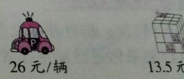

# Mathematics (Grade 6)

**ID**: 4f05c714
**难度**: hard
**题型**: fill_in_the_blank

## 题目
1、用含有字母的式子填空.
 （1）莉莉今年11岁，比东东大m岁，东东今年(    ),8年后，莉莉比东东大(    )岁
 （2）文文有20元，买文具用去a元，还剩
 (    )元
 （3）每盒铅笔有18支，x盒共有(    )支铅笔
 （4）①买a辆玩具车需要(    )元
 ②用m元可以买(    )个魔方.

 26元/辆
 13.5元/个

## 解答

**答案**: 11-m, m, 20-a, 18x, 26a, 13.5m

1. Step1:已知莉莉今年11岁，比东东大m岁，那么东东今年的年龄是用莉莉的年龄11减去大的岁数m，即11 - m
2. Step2:因为年龄差始终不变，所以8年后莉莉还是比东东大m岁
3. Step3:已知文文有20元，买文具用去a元，剩下的钱是用总钱数20减去用去的a元，即20 - a
4. Step4:已知每盒铅笔有18支，有x盒，铅笔总数是用每盒的支数18乘以盒数x，即18x
5. Step5:已知玩具车单价26元/辆，买a辆，总价是用单价26乘以数量a，即26a
6. Step6:已知魔方单价13.5元/个，有m元，能买的数量是用总钱数m除以单价13.5，即m÷13.5，可写成13.5m

## 知识点

**知识点**:
  - --

---
