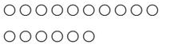

# Mathematics (Grade 6)

**ID**: 4f139db7
**难度**: hard
**题型**: fill_in_the_blank

## 题目

第一行比第二行多（）个。
第一行拿走（）个，与第二行同样多。
第二行增加（）个，与第一行同样多。
第一行给第二行（）个，两行同样多。

## 解答

**答案**: 4, 4, 4, 2

1. Step1:数出第一行圆的个数为10个
2. Step2:数出第二行圆的个数为6个
3. Step3:计算第一行比第二行多的个数，10 - 6 = 4个
4. Step4:得出第一行拿走4个与第二行同样多
5. Step5:得出第二行增加4个与第一行同样多
6. Step6:计算两行相差4个，4÷2 = 2个，得出第一行给第二行2个两行同样多

## 知识点

**知识点**:
  - 

---
