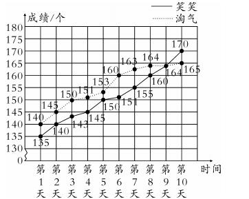

# Mathematics (Grade 6)

**ID**: 513b380c
**难度**: hard
**题型**: fill_in_the_blank

## 题目
笑笑和淘气为参加踢沙包比赛， 提前10天进行训练，下面是它们每天踢沙包成绩统计图。

1.笑笑和淘气第1天踢沙包个数相差（）个，第10天踢沙包个数相差（）个。
2.根据统计图，请你分析笑笑和淘气这10天里踢沙包成绩分别呈什么变化趋势。谁的进步幅度大？

## 解答

**答案**: 5, 5, 笑笑和淘气这10天里踢沙包成绩都是不断增多的趋势，笑笑的进步幅度大。

1. Step1:从折线统计图中获取笑笑第1天踢沙包个数为135个，淘气第1天踢沙包个数为140个，用淘气第1天踢沙包个数减去笑笑第1天踢沙包个数，即140 - 135 = 5个，得到笑笑和淘气第1天踢沙包个数相差5个
2. Step2:从折线统计图中获取笑笑第10天踢沙包个数为170个，淘气第10天踢沙包个数为165个，用笑笑第10天踢沙包个数减去淘气第10天踢沙包个数，即170 - 165 = 5个，得到笑笑和淘气第10天踢沙包个数相差5个
3. Step3:观察折线统计图，发现笑笑和淘气的成绩折线都是上升趋势，得出笑笑和淘气这10天里踢沙包成绩都是不断增多的趋势
4. Step4:比较笑笑和淘气成绩折线的上升幅度，发现笑笑的上升趋势更快，得出笑笑的进步幅度大

## 知识点

**知识点**:
  - 复式折线统计图

---
