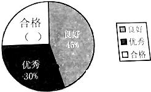

# Mathematics (Grade 6)

**ID**: 51acee03
**难度**: hard
**题型**: fill_in_the_blank

## 题目
如图是东风小学六年级上学期期末体育成绩统计图：图中表示良好的圆心角是 $\underline{\hspace{5em}}$ 度，已知合格有50人，东风小学六年级共有学生 $\underline{\hspace{5em}}$ 人，优秀的有 $\underline{\hspace{5em}}$ 人．

## 解答

**答案**: 162, 200, 60

1. Step1:因为整个圆的圆心角是360°，良好人数占比45%，所以良好对应的圆心角为360°×45% = 162°
2. Step2:因为优秀占30%，良好占45%，所以合格人数占比为1 - 30% - 45% = 25%，又已知合格有50人，根据已知部分求整体用除法，可得六年级总人数为50÷25% = 200人
3. Step3:已知六年级总人数为200人，优秀人数占比30%，根据求一个数的百分之几是多少用乘法，可得优秀人数为200×30% = 60人

## 知识点

**知识点**:
  - 扇形统计图

---
