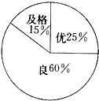

# Mathematics (Grade 6)

**ID**: 5308bb0e
**难度**: hard
**题型**: fill_in_the_blank

## 题目
如图是某班40名同学期末数学测验成绩统计图．
（1）这是$\underline{\hspace{5em}}$统计图．
（2）该班获良好的学生有$\underline{\hspace{5em}}$人．
（3）该班获得优秀的人数比及格的人数多$\underline{\hspace{5em}}$%．

## 解答

**答案**: 扇形, 24, 66.7

1. Step1:根据统计图的形状和特征，判断这是扇形统计图
2. Step2:已知总人数为40人，获良好的学生占比60%，计算获良好的学生人数，即40×60% = 24人
3. Step3:先计算获得优秀的人数为40×25% = 10人，及格的人数为40×15% = 6人，再计算获得优秀的人数比及格的人数多的比例，即(10 - 6)÷6≈66.7%

## 知识点

**知识点**:
  - 扇形统计图；从统计图表中获取信息．

---
