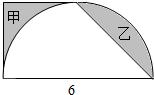

# Mathematics (Grade 6)

**ID**: 54726bc7
**难度**: hard
**题型**: fill_in_the_blank

## 题目
如图是一个直角梯形中以梯形的下底为直径画出一个半圆形，梯形的上底是下底的50%，阴影甲的面积比阴影乙的面积小1.4厘米$^{2}$．则图中空白部分的面积是 $\underline{\hspace{5em}}$ 厘米$^{2}$．

## 解答

**答案**: 25.7

1. Step1:根据条件可知梯形的上底是下底的50%，下底为6，则上底为6×50% = 3。同时由“在一个直角梯形中以梯形的下底为直径，画出一个半圆形”可知梯形的高等于半圆的半径，即高为6÷2 = 3。
2. Step2:设梯形的高为x，则上底为x，下底为2x。根据“阴影甲的面积比阴影乙的面积小1.4厘米²”，可得半圆面积 - 梯形面积 = 1.4，即3.14×x²÷2 - （x + 2x）×x÷2 = 1.4。
3. Step3:对3.14×x²÷2 - （x + 2x）×x÷2 = 1.4进行化简计算：1.57x² - 3x²×$\frac{1}{2}$ = 1.4，1.57x² - 1.5x² = 1.4，0.07x² = 1.4，解得x² = 20。
4. Step4:计算空白部分面积，空白部分由$\frac{1}{4}$圆和一个直角三角形组成，其面积为3.14×20×$\frac{1}{4}$ + 20÷2 = 15.7 + 10 = 25.7（平方厘米）

## 知识点

**知识点**:
  - 组合图形的面积

---
