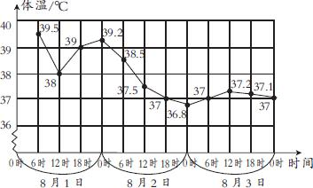

# Mathematics (Grade 6)

**ID**: 5551da06
**难度**: hard
**题型**: fill_in_the_blank

## 题目
观察统计图回答问题。

【小题1】上面的统计图是（____）统计图，横轴表示（____），纵轴表示（____），纵轴每个单位长度表示（____），图中各点表示各个时刻的（____）。
【小题2】由图可知，明明生病时每隔（____）小时测量一次体温。
【小题3】哪个时间段明明体温下降最快？哪个时间段体温比较稳定？
【小题4】明明的体温总体呈什么趋势？说明了什么问题？

## 解答

**答案**: 折线, 时间, 体温, 1℃, 体温, 6, 8月1日6时至12时, 8月2日18时至8月4日0时, 体温先降后升再稳步下降, 说明病情好转

1. Step1:观察统计图的形状，可得出该统计图是折线统计图
2. Step2:查看横轴标注，可知横轴表示时间
3. Step3:查看纵轴标注，可知纵轴表示体温
4. Step4:观察纵轴刻度，相邻刻度差值为1，可知纵轴每个单位长度表示1℃
5. Step5:根据统计图意义，可知图中各点表示各个时刻的体温
6. Step6:观察相邻测量时间的间隔，可知明明生病时每隔6小时测量一次体温
7. Step7:观察折线下降幅度，可知8月1日6时至12时体温下降最快
8. Step8:观察折线平稳程度，可知8月2日18时至8月4日0时体温比较稳定
9. Step9:整体观察体温变化，可知明明的体温总体呈体温先降后升再稳步下降
10. Step10:结合生活常识，可知体温先降后升再稳步下降说明病情好转

## 知识点

**知识点**:
  - 小学数学;统计和概率;统计;统计图

---
