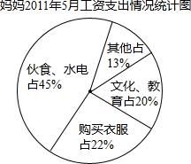

# Mathematics (Grade 6)

**ID**: 55b8081a
**难度**: hard
**题型**: fill_in_the_blank

## 题目
根据如图信息回答问题．
（1）$\underline{\hspace{5em}}$支出最多，占$\underline{\hspace{5em}}$%．
（2）文化教育支出与买衣服支出的最简整数比是$\underline{\hspace{5em}}$．
（3）请你对妈妈本月的工资支出情况提出一条合理的建议．
建议：$\underline{\hspace{5em}}$．

## 解答

**答案**: 伙食、水、电, 45, 10：11, 下月用于购买衣服的支出应该少于文化、教育的支出

1. Step1:观察扇形统计图，比较各部分占比大小，得出伙食、水电支出占比45%，是最大的，所以第一个空填伙食、水、电，第二个空填45
2. Step2:已知文化教育支出占总支出的20%，买衣服支出占总支出的22%，将20%：22%化简，两边同时除以2%，得到10：11，所以第三个空填10：11
3. Step3:对比购买衣服支出占比22%和文化教育支出占比20%，因为购买衣服支出占比大于文化教育支出占比，所以提出建议下月用于购买衣服的支出应该少于文化、教育的支出，即第四个空的答案

## 知识点

**知识点**:
  - 统计图表的综合分析、解释和应用．

---
