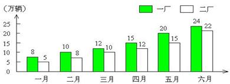

# Mathematics (Grade 6)

**ID**: 589674c3
**难度**: hard
**题型**: fill_in_the_blank

## 题目
如图是两家玩具厂2008年上半年产量统计图，看图回答问题．

（1）一厂上半年总产量是 $\underline{\hspace{5em}}$ 万辆．
（2）二厂上半年总产量是 $\underline{\hspace{5em}}$ 万辆．
（3）二厂上半年平均每月产量是 $\underline{\hspace{5em}}$ 万辆．
（4）一厂第二季度比第一季度增产 $\underline{\hspace{5em}}$ 万辆．
（5）第二季度一厂的产量比二厂的产量多 $\underline{\hspace{5em}}$ 万辆．

## 解答

**答案**: 89, 72, 12, 29, 10

1. Step1:计算一厂上半年总产量，将一厂一月产量8万辆、二月产量10万辆、三月产量12万辆、四月产量15万辆、五月产量20万辆、六月产量24万辆相加，即8+10+12+15+20+24=89万辆
2. Step2:计算二厂上半年总产量，将二厂一月产量5万辆、二月产量8万辆、三月产量10万辆、四月产量12万辆、五月产量15万辆、六月产量22万辆相加，即5+8+10+12+15+22=72万辆
3. Step3:计算二厂上半年平均每月产量，用二厂上半年总产量72万辆除以6，即72÷6=12万辆
4. Step4:计算一厂第二季度比第一季度增产数量，先算出一厂第二季度（四月、五月、六月）总产量为15+20+24=59万辆，第一季度（一月、二月、三月）总产量为8+10+12=30万辆，然后相减59-30=29万辆
5. Step5:计算第二季度一厂的产量比二厂的产量多的数量，先算出第二季度一厂产量为15+20+24=59万辆，二厂产量为12+15+22=49万辆，然后相减59-49=10万辆

## 知识点

**知识点**:
  - 以一当五（或以上）的条形统计图;从统计图表中获取信息

---
