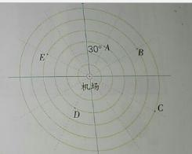

# Mathematics (Grade 6)

**ID**: 5b35c733
**难度**: hard
**题型**: fill_in_the_blank

## 题目
下图是一个飞机场的雷达屏幕，每相邻两个圆之间的距离表示10千米。以机场为观测点，飞机A在北偏东30°方向30千米处。根据图中表示的飞机B、 C、 D、E的位置，完成下面的填空。
 飞机B在北偏东(    )° 方向(    )千米处
 飞机C在(    )偏东(    )方向(    )千米处
 飞机D在(    )偏(    )(    )°方向(    )千米处
 飞机E在(    )偏(    )(    )°方向千米处

## 解答

**答案**: 60°, 50, 南, 60°, 60, 南, 西, 30°, 20, 北, 西, 60°, 40

1. Step1:根据解析2可知圆周上两条相邻直线之间的夹角为30度，相邻的圆周之间的距离为10千米。观察飞机B的位置，其与北方向夹角跨越2个间隔，所以角度为30×2 = 60°，距离为相邻圆周距离的5倍，即10×5 = 50千米
2. Step2:观察飞机C的位置，其在南偏东方向，与东方向夹角跨越2个间隔，角度为30×2 = 60°，距离为相邻圆周距离的6倍，即10×6 = 60千米
3. Step3:观察飞机D的位置，其在南偏西方向，与南方向夹角跨越1个间隔，角度为30°，距离为相邻圆周距离的2倍，即10×2 = 20千米
4. Step4:观察飞机E的位置，其在北偏西方向，与北方向夹角跨越2个间隔，角度为30×2 = 60°，距离为相邻圆周距离的4倍，即10×4 = 40千米

## 知识点

**知识点**:
  - 

---
