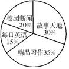

# Mathematics (Grade 6)

**ID**: 5e8eb984
**难度**: hard
**题型**: fill_in_the_blank

## 题目
实验小学红领巾广播站每周播音时间为200分钟，下图是每个栏目的时间分配图。

（1）（）个栏目播音的时间最长，每周播音（）分钟。
（2）《校园新闻》每周播音的时间比《每日英语》多（）分钟。

## 解答

**答案**: 《精品习作》, 70, 10

1. Step1:比较各栏目所占百分比大小，15%＜20%＜30%＜35%，可知《精品习作》所占百分比最大，所以《精品习作》播音时间最长
2. Step2:已知总播音时间为200分钟，《精品习作》占35%，则其每周播音时间为200×35%=70分钟
3. Step3:先算出《校园新闻》比《每日英语》多占的百分比为20%-15%=5%，总播音时间为200分钟，所以《校园新闻》每周播音的时间比《每日英语》多200×5%=10分钟

## 知识点

**知识点**:
  - 从统计图表中获取信息;百分数的认识

---
