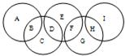

# Mathematics (Grade 6)

**ID**: 6119dfeb
**难度**: hard
**题型**: fill_in_the_blank

## 题目
如图，A，B，C，D，E，F，G，H，I代表九个各不相同的正整数，且每个圆中所填数的和都等于2008．这九个数总和最小为$\underline{\hspace{5em}}$．

## 解答

**答案**: 5028

1. Step1:根据每个圆中所填数的和都等于2008，得出（A+C+E+G+I）+2（B+D+F+H）=2008×5
2. Step2:分析可知当（A+C+E+G+I）最小时，这九个数总和才最小
3. Step3:因为A，B，C，D，E，F，G，H，I是九个各不相同的正整数，且（A+C+E+G+I）应为偶数，所以确定A+C+E+G+I=1+2+3+4+6=16
4. Step4:将A+C+E+G+I=16代入（A+C+E+G+I）+2（B+D+F+H）=2008×5，即16+2（B+D+F+H）=10040，计算得出B+D+F+H=5012
5. Step5:计算九个数总和A+C+E+G+I+B+D+F+H，即5012+16=5028

## 知识点

**知识点**:
  - 数字和问题．

---
