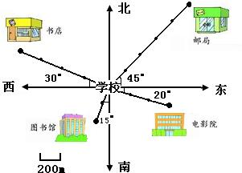

# Mathematics (Grade 6)

**ID**: 62037661
**难度**: hard
**题型**: fill_in_the_blank

## 题目
以学校为观测点：
①邮局在学校北偏$\underline{\hspace{5em}}$的方向上，距离是$\underline{\hspace{5em}}$米．
②书店在学校$\underline{\hspace{5em}}$的方向上，距离是$\underline{\hspace{5em}}$米．
③图书馆在学校$\underline{\hspace{5em}}$的方向上，距离是$\underline{\hspace{5em}}$米．
④电影院在学校$\underline{\hspace{5em}}$的方向上，距离是$\underline{\hspace{5em}}$米．

## 解答

**答案**: 东45°, 1000, 西偏北30°, 800, 南偏西15°, 400, 东偏南20°, 600

1. Step1:根据地图方向‘上北下南，左西右东’，以学校为观测点，确定邮局在北偏东方向，其角度为45°；由图中线段比例尺可知图上1厘米代表实际距离200米，邮局与学校图上距离为5厘米，计算距离为200×5 = 1000米
2. Step2:以学校为观测点，确定书店在西偏北方向，角度为30°，书店与学校图上距离为4厘米，计算距离为200×4 = 800米
3. Step3:以学校为观测点，确定图书馆在南偏西方向，角度为15°，图书馆与学校图上距离为2厘米，计算距离为200×2 = 400米
4. Step4:以学校为观测点，确定电影院在东偏南方向，角度为20°，电影院与学校图上距离为3厘米，计算距离为200×3 = 600米

## 知识点

**知识点**:
  - 根据方向和距离确定物体的位置．

---
