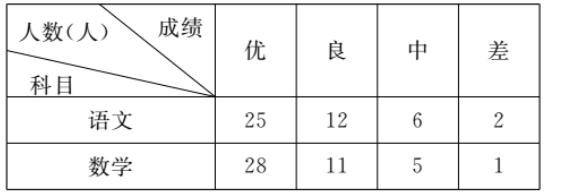

# Mathematics (Grade 6)

**ID**: 63374d48
**难度**: hard
**题型**: fill_in_the_blank

## 题目
下面分别二（1）班上学期语文和数学期末测试成绩统计情况，观察下表回答问题。

1.二（1）班共有学生（）人。
2.语文成绩得（）的人数最多，得（）的人数最少。
3.数学成绩得（）的人数最多，得（）的人数最少。
4.语文成绩中，成绩在良以上（包括良）的有（）人，得优的人数比得良的多（）人。
5.语文成绩和数学成绩比较，这个班（）成绩较好，语文得优的人数比数学得优的少（）人。

## 解答

**答案**: 45, 优, 差, 优, 差, 37, 13, 数学, 3

1. Step1:计算二（1）班学生总数，将语文成绩各等级人数相加，25 + 12 + 6 + 2 = 45人
2. Step2:观察语文成绩人数分布，得优的人数为25人最多，得差的人数为2人最少
3. Step3:观察数学成绩人数分布，得优的人数为28人最多，得差的人数为1人最少
4. Step4:计算语文成绩在良以上（包括良）的人数，25 + 12 = 37人；计算语文得优的人数比得良的多的人数，25 - 12 = 13人
5. Step5:比较语文和数学成绩在良以上（包括良）的人数，数学成绩在良以上（包括良）的人数比语文多，所以数学成绩较好；计算语文得优的人数比数学得优的少的人数，28 - 25 = 3人

## 知识点

**知识点**:
  - 从统计图表中获取信息;整数的加法和减法;复式统计表

---
