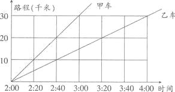

# Mathematics (Grade 6)

**ID**: 66b6bd67
**难度**: hard
**题型**: fill_in_the_blank

## 题目
根据甲、乙两车的行程图表填空。

（1）甲车每小时行________千米，乙车每小时行________千米。   
（2）甲车行驶的路程和时间成________比例，乙车行驶的路程和时间成________比例。   
（3）甲车行驶4.5小时，一共行驶了多少千米?乙车行驶90千米需要多少小时?

## 解答

**答案**: 30, 15, 正, 正, 135千米, 6小时

1. Step1:计算甲车速度，从图表可知甲车1小时行驶30千米，所以甲车速度为30÷1 = 30千米/小时
2. Step2:计算乙车速度，从图表可知乙车2小时行驶30千米，所以乙车速度为30÷2 = 15千米/小时
3. Step3:判断甲车行驶的路程和时间的比例关系，因为其图像是直线，所以成正比例
4. Step4:判断乙车行驶的路程和时间的比例关系，因为其图像是直线，所以成正比例
5. Step5:计算甲车行驶4.5小时的路程，速度为30千米/小时，路程为4.5×30 = 135千米
6. Step6:计算乙车行驶90千米所需时间，速度为15千米/小时，时间为90÷15 = 6小时

## 知识点

**知识点**:
  - 小学数学;数与代数;比和比例;比例;正比例、反比例的应用

---
