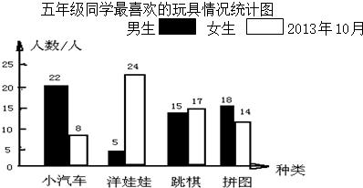

# Mathematics (Grade 6)

**ID**: 674e12a8
**难度**: hard
**题型**: fill_in_the_blank

## 题目
根据如图的统计图填空．

（1）纵轴上的每格表示 $\underline{\hspace{5em}}$ 名学生．
（2）喜欢 $\underline{\hspace{5em}}$ 的男、女生人数相差最大；喜欢 $\underline{\hspace{5em}}$ 的男、女生人数差不多．
（3）男生中喜欢 $\underline{\hspace{5em}}$ 人的最多，有 $\underline{\hspace{5em}}$ 人．

## 解答

**答案**: 5, 洋娃娃, 跳棋, 小汽车, 22

1. Step1:观察统计图纵轴，发现数据依次为0、5、10、15、20等，由此可知纵轴上每格表示5名学生
2. Step2:分别计算喜欢每种玩具的男、女生人数差值，小汽车：22 - 8 = 14人；洋娃娃：24 - 5 = 19人；跳棋：17 - 15 = 2人；拼图：18 - 14 = 4人，比较差值大小19＞14＞4＞2，所以喜欢洋娃娃的男、女生人数相差最大，喜欢跳棋的男、女生人数差不多
3. Step3:观察男生对应的条形图高度，发现喜欢小汽车对应的条形最高，人数为22人，所以男生中喜欢小汽车的最多，有22人

## 知识点

**知识点**:
  - 两种不同形式的复式条形统计图

---
