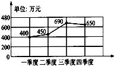

# Mathematics (Grade 6)

**ID**: 6831f52c
**难度**: hard
**题型**: fill_in_the_blank

## 题目

(2010•大英县模拟)如图是某手机专卖店2008年各季度销售收入统计图：
(1)如图是______统计图；
(2)前三季度平均每月销售收入是______万元；
(3)第三季度比第一季度增收______%．
(4)请你预测这个专卖店今年销售收入会达到______万元．

## 解答

**答案**: 折线, 171.1, 72.5, 2300

1. Step1:观察统计图的形状，可判断图中是折线统计图
2. Step2:先计算前三季度销售收入总和为400 + 450 + 690 = 1540万元，再除以9，即1540÷9≈171.1万元，得到前三季度平均每月销售收入
3. Step3:先算出第三季度比第一季度多的销售收入为690 - 400 = 290万元，再除以第一季度销售收入400万元，即290÷400 = 72.5%，得到第三季度比第一季度增收的百分比
4. Step4:把各季度销售收入400、450、690、650看作整百数400、500、700、700进行估算，400 + 500 + 700 + 700 = 2300万元，得到预测的今年销售收入

## 知识点

**知识点**:
  - 单式折线统计图;从统计图表中获取信息．

---
