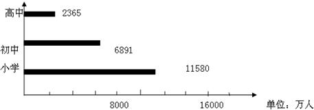

# Mathematics (Grade 6)

**ID**: 691ccd4d
**难度**: hard
**题型**: fill_in_the_blank

## 题目
根据统计图回答问题．
如图是我国2005年基础教育在校人数统计图：

（1）读出我国2005年基础教育各类学校在校学生人数．
高中： $\underline{\hspace{5em}}$ ，初中： $\underline{\hspace{5em}}$ ，小学： $\underline{\hspace{5em}}$ 
（2）哪类学生人数超过了1亿？哪类学生人数还不到1亿？与1亿相差多少？
（3）你还能提出什么数学问题，并解答．

## 解答

**答案**: 二千三百六十五万, 六千八百九十一万, 一万一千五百八十万, 高中生人数与1亿相差76350000，初中生人数与1亿相差31060000，小学生人数与1亿相差15800000, 小学生比高中、初中总人数多约25.1%

1. Step1:根据整数读法规则，从高位到低位，一级一级地读，每一级末尾的0都不读出来，其余数位连续几个0都只读一个零，读出高中人数2365万为二千三百六十五万
2. Step2:同样根据整数读法规则，读出初中人数6891万为六千八百九十一万
3. Step3:依据整数读法规则，读出小学人数11580万为一万一千五百八十万
4. Step4:将2365万人换算为23650000人，6891万人换算为68910000人，11580万人换算为115800000人，1亿人换算为100000000人
5. Step5:计算高中生人数与1亿的差值，100000000 - 23650000 = 76350000
6. Step6:计算初中生人数与1亿的差值，100000000 - 68910000 = 31060000
7. Step7:计算小学生人数与1亿的差值，115800000 - 100000000 = 15800000
8. Step8:提出问题“小学生比高中、初中总人数多百分之几？”，先计算高中和初中总人数，2365 + 6891 = 9256
9. Step9:计算小学人数与高中、初中总人数的差值，11580 - 9256 = 2324
10. Step10:用差值除以高中、初中总人数，2324÷9256 ≈ 25.1%

## 知识点

**知识点**:
  - 从统计图表中获取信息

---
