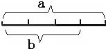

# Mathematics (Grade 6)

**ID**: 698a0ce0
**难度**: hard
**题型**: fill_in_the_blank

## 题目
如图中的数量关系可以表示为 $\underline{\hspace{5em}}$ ×$\frac{3}{4}$= $\underline{\hspace{5em}}$ ；
改写成除法算式是 $\underline{\hspace{5em}}$ ÷$\frac{3}{4}$= $\underline{\hspace{5em}}$ ；
根据比的意义，可表示为b：a=（ $\underline{\hspace{5em}}$ ： $\underline{\hspace{5em}}$ ）．

## 解答

**答案**: a, b, b, a, 3, 4

1. Step1:把a看作单位“1”，因为b是a的$rac{3}{4}$，根据一个数乘分数的意义，所以第一个空填a，第二个空填b
2. Step2:由a×$rac{3}{4}=b$，根据已知一个数的几分之几是多少，求这个数用除法，所以第三个空填b，第四个空填a
3. Step3:因为b是a的$rac{3}{4}$，即b：a=$rac{3}{4}$=3：4，所以第五个空填3，第六个空填4

## 知识点

**知识点**:
  - 分数乘法应用题;分数乘法;分数除法;比的意义

---
