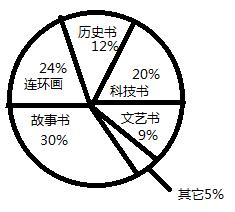

# Mathematics (Grade 6)

**ID**: 6a5ccee8
**难度**: hard
**题型**: fill_in_the_blank

## 题目
向阳小学图书馆图书数量情况统计图(如图)。请根据图中信息解答下面的问题。
 (1)历史书的本数是故事书的(    )%。
 (2)连环画的本数比科技书多(    )%。
 (3)若图书馆一共有图书40000本，则文艺书比历史书少(    )本。
 (4)若文艺书和历史书一共有6300本，则图书馆一共有图书多少本？(列式解答)

 历史书12%  科技书20% 文艺书9% 其它5% 故事书30% 连环画24%

## 解答

**答案**: 40, 4, 1200, 30000

1. Step1:计算历史书的本数是故事书的百分之几，用历史书所占百分比除以故事书所占百分比，即12%÷30%=0.4=40%
2. Step2:计算连环画的本数比科技书多的百分比，用连环画所占百分比减去科技书所占百分比，即24%-20%=4%
3. Step3:先计算文艺书比历史书少的百分比为12%-9%=3%，已知图书馆一共有图书40000本，再用总数乘以少的百分比得出文艺书比历史书少的本数，即3%×40000=1200本
4. Step4:先计算文艺书和历史书一共占总数的百分比为12%+9%=21%，已知文艺书和历史书一共有6300本，再用6300除以其占总数的百分比得出图书馆图书总数，即6300÷21%=30000本

## 知识点

**知识点**:
  - --

---
