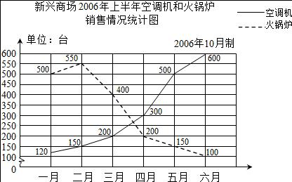

# Mathematics (Grade 6)

**ID**: 6ef038a5
**难度**: hard
**题型**: fill_in_the_blank

## 题目
新兴商场2006年上半年空调机和火锅炉销售情况统计如下：

（1）$\underline{\hspace{5em}}$月份的空调机销量最高，$\underline{\hspace{5em}}$月份的火锅炉销量最高．
（2）空调机五月份的销量比二月份多$\underline{\hspace{5em}}$台．
（3）仔细观察空调机和火锅炉销量的变化情况，你发现了什么？

## 解答

**答案**: 六, 二, 350

1. Step1:观察折线统计图，确定空调机销量最高的月份，可知六月份空调机销量最高，达到600台，所以第一个空填六
2. Step2:观察折线统计图，确定火锅炉销量最高的月份，可知二月份火锅炉销量最高，达到550台，所以第二个空填二
3. Step3:找到空调机五月份销量为500台，二月份销量为150台，计算500 - 150 = 350台，所以第三个空填350

## 知识点

**知识点**:
  - 统计图表的综合分析、解释和应用．

---
