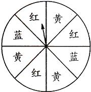

# Mathematics (Grade 6)

**ID**: 6f6f8ae6
**难度**: hard
**题型**: fill_in_the_blank

## 题目

(1)指针停在红色区域的可能性是______．
指针停在黄色区域的可能性是______．
指针停在蓝色区域的可能性是______．
(2)指针停在______区域与______区域的可能性相同，停在______区域的可能性最小．

## 解答

**答案**: $\frac{3}{8}$, $\frac{3}{8}$, $\frac{1}{4}$, 红色, 黄色, 蓝色

1. Step1:观察图形可知总区域被平均分成了8份
2. Step2:因为红色区域占3份，所以指针停在红色区域的可能性为3÷8=$\frac{3}{8}$
3. Step3:由于黄色区域占3份，所以指针停在黄色区域的可能性为3÷8=$\frac{3}{8}$
4. Step4:鉴于蓝色区域占2份，所以指针停在蓝色区域的可能性为2÷8=$\frac{1}{4}$
5. Step5:比较$\frac{3}{8}$、$\frac{3}{8}$、$\frac{1}{4}$的大小，可得$\frac{3}{8}$=$\frac{3}{8}$＞$\frac{1}{4}$
6. Step6:根据比较结果得出指针停在红色区域与黄色区域的可能性相同，停在蓝色区域的可能性最小

## 知识点

**知识点**:
  - 简单事件发生的可能性求解．

---
