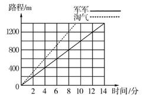

# Mathematics (Grade 6)

**ID**: 729037e1
**难度**: hard
**题型**: fill_in_the_blank

## 题目
根据图表回答下列问题。
1.从图上可以看出，淘气每分钟跑（）m，军军每分钟跑（）m。
2.淘气12分钟跑（）m，军军（）分钟能跑1500m。
3.淘气跑的路程与时间成（）比例。
4.军军提前2分钟跑，淘气跑（）分钟才能追上淘气。

## 解答

**答案**: 150, 100, 1800, 15, 正, 4

1. Step1:根据图表，淘气4分钟跑了600米，由速度=路程÷时间，可得淘气每分钟跑600÷4 = 150m
2. Step2:根据图表，军军2分钟跑了200米，由速度=路程÷时间，可得军军每分钟跑200÷2 = 100m
3. Step3:已知淘气速度为150m/分钟，根据路程=速度×时间，可得淘气12分钟跑150×12 = 1800m
4. Step4:已知军军速度为100m/分钟，根据时间=路程÷速度，可得军军跑1500m需要1500÷100 = 15分钟
5. Step5:因为淘气跑的路程与所用时间的比值一定，根据正比例的定义，可知淘气跑的路程与时间成正比例
6. Step6:设淘气x分钟才能追上军军，军军提前2分钟跑，则军军跑的时间为(x + 2)分钟，根据两人跑的路程相等列出方程150x=(2 + x)×100，求解得x = 4

## 知识点

**知识点**:
  - 简单的行程问题;正比例和反比例的意义

---
