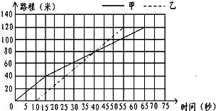

# Mathematics (Grade 6)

**ID**: 749dd563
**难度**: hard
**题型**: fill_in_the_blank

## 题目
甲、乙两人比赛120米滑雪，乙让甲先滑10秒．他们两人滑的路程与时间的关系如图．

(1)在滑完全程中，______滑行的路程和时间成正比例．
(2)甲滑完全程的平均速度是每秒______米；乙滑完全程的平均速度是每秒______米．

## 解答

**答案**: 乙, 1\\frac{11}{13}, 2\\frac{2}{3}

1. Step1:观察统计图，发现虚线是一条直线，实线是折线，且虚线表示乙滑的路程与时间的关系，根据路程与时间成正比例关系在统计图中是一条直线，得出乙滑行的路程和时间成正比例
2. Step2:从图中可知甲滑行的路程是120米，所用时间是65秒，根据速度 = 路程÷时间，计算甲滑完全程的平均速度为120÷65 = 1$rac{11}{13}$米/秒
3. Step3:从图中可知乙滑行的路程是120米，所用时间是45秒，根据速度 = 路程÷时间，计算乙滑完全程的平均速度为120÷45 = 2$rac{2}{3}$米/秒

## 知识点

**知识点**:
  - 复式折线统计图;简单的行程问题;辨识成正比例的量与成反比例的量．

---
