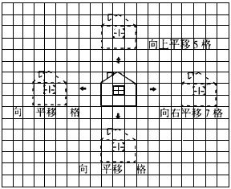

# Mathematics (Grade 6)

**ID**: 7912b884
**难度**: hard
**题型**: fill_in_the_blank

## 题目
在方格纸上平移图形的方法：平移图形时，把这个图形的各个顶点按指定的方向和格子数平移到新位置，先描出各点，再把各点按原图顺序连接起来，便是按要求平移后得到的新图形。

把小房子向________平移________格得到左侧的小房子；把小房子向________平移________格得到下面的小房子。

## 解答

**答案**: 左, 6, 下, 5

1. Step1:观察图形，确定要找到小房子平移得到左侧小房子的方向和格数
2. Step2:对比小房子和左侧小房子的位置，得出小房子向左平移6格可得到左侧小房子
3. Step3:确定要找到小房子平移得到下面小房子的方向和格数
4. Step4:对比小房子和下面小房子的位置，得出小房子向下平移5格可得到下面小房子

## 知识点

**知识点**:
  - 

---
