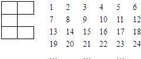

# Mathematics (Grade 6)

**ID**: 79a5f69e
**难度**: hard
**题型**: fill_in_the_blank

## 题目
如图，从1开始的连续自然数排成了一个数表，现在用一个“C”字型套中五个数，把这五个数相加的和比一个完全平方数少2，那么这个完全平方数最小可能是$\underline{\hspace{5em}}$；如果这个完全平方数是离1000最近的一个，那么它可能是$\underline{\hspace{5em}}$．

## 解答

**答案**: 49, 1024

1. Step1:设用“C”字型套中最小的数为x，则其余四个数分别为x+6，x+12，x+1，x+13
2. Step2:计算五个数的和为x+x+6+x+12+x+1+x+13=5x+32
3. Step3:根据条件可知5x+32+2=5x+34是一个完全平方数
4. Step4:因为5x+34是完全平方数，且该平方数去掉34后是5的倍数，5的倍数个位是0或者5，所以该平方数个位是4
5. Step5:找出个位是4的最小完全平方数为49，即求最小完全平方数时答案为49
6. Step6:找出30²=900，31²=961，32²=1024，其中离1000最近且个位是4的是1024，即求离1000最近的完全平方数时答案为1024

## 知识点

**知识点**:
  - 完全平方数性质．

---
