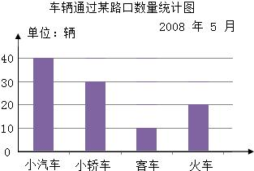

# Mathematics (Grade 6)

**ID**: 7b562953
**难度**: hard
**题型**: fill_in_the_blank

## 题目
杨阳在一个路口用10分钟时间统计各种车辆通过的数量，请你根据图中的数据解答问题．

（1）这是一个$\underline{\hspace{5em}}$统计图，它的优点是$\underline{\hspace{5em}}$．
（2）这个路口平均每分钟通过$\underline{\hspace{5em}}$辆车．
（3）10分钟内通过的货车比小汽车少$\underline{\hspace{5em}}$%．
（4）对统计图的数据，你有什么想法？$\underline{\hspace{5em}}$．

## 解答

**答案**: 条形统计图, 容易看出数量的多少, 10, 50, 现在的车辆很多，要尽量少开车，注意环保

1. Step1:观察统计图可知这是一个条形统计图，根据条形统计图的特点，其优点是容易看出数量的多少
2. Step2:先计算10分钟内通过车辆的总数，即40 + 30 + 10 + 20 = 100辆，再用总数除以时间10分钟，100÷10 = 10辆，得到这个路口平均每分钟通过10辆车
3. Step3:先算出10分钟内通过的货车比小汽车少的数量，40 - 20 = 20辆，再用少的数量除以小汽车的数量，20÷40 = 50%，得出10分钟内通过的货车比小汽车少50%
4. Step4:根据统计数据中车辆数量较多的情况，提出现在的车辆很多，要尽量少开车，注意环保的想法

## 知识点

**知识点**:
  - 以一当五（或以上）的条形统计图；平均数的含义及求平均数的方法；从统计图表中获取信息；统计图表的综合分析、解释和应用．

---
