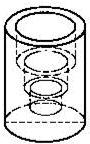

# Mathematics (Grade 6)

**ID**: 7c16781f
**难度**: hard
**题型**: fill_in_the_blank

## 题目
如图是一个半径为4厘米，高为4厘米的圆柱体，在它的中间依次向下挖半径分别为3厘米、2厘米、1厘米，高分别为2厘米、1厘米、0.5厘米的圆柱体，则最后得到的立体图形表面积是______平方厘米．

## 解答

**答案**: 254.34

1. Step1:根据公式'圆柱的表面积=侧面积+底面积×2'和'圆柱的侧面积=底面周长×高=2πrh'，计算大圆柱的表面积，即2×3.14×4×4+3.14×4²×2=100.48+100.48=200.96平方厘米
2. Step2:根据公式'圆柱的侧面积=底面周长×高=2πrh'，分别计算三个小圆柱的侧面积，半径为3厘米、高为2厘米的小圆柱侧面积为2×3.14×3×2=37.68平方厘米，半径为2厘米、高为1厘米的小圆柱侧面积为2×3.14×2×1=12.56平方厘米，半径为1厘米、高为0.5厘米的小圆柱侧面积为2×3.14×1×0.5=3.14平方厘米
3. Step3:将大圆柱的表面积与三个小圆柱的侧面积相加，200.96+37.68+12.56+3.14=254.34平方厘米，得到最后立体图形的表面积

## 知识点

**知识点**:
  - 规则立体图形的表面积．

---
