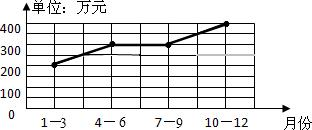

# Mathematics (Grade 6)

**ID**: 7c3538c9
**难度**: hard
**题型**: fill_in_the_blank

## 题目
如图是某厂2007年产值情况统计图，这个厂下半年比上半年产值增长了$\underline{\hspace{5em}}$%，全年平均每月产值是$\underline{\hspace{5em}}$万元．

## 解答

**答案**: 40, 100

1. Step1:计算上半年产值，200 + 300 = 500万元
2. Step2:计算下半年产值，300 + 400 = 700万元
3. Step3:计算下半年比上半年增长的产值，700 - 500 = 200万元
4. Step4:计算下半年比上半年产值增长的百分比，200÷500×100% = 40%
5. Step5:计算全年总产值，500 + 700 = 1200万元
6. Step6:计算全年平均每月产值，1200÷12 = 100万元

## 知识点

**知识点**:
  - 百分数的实际应用；平均数的含义及求平均数的方法．

---
