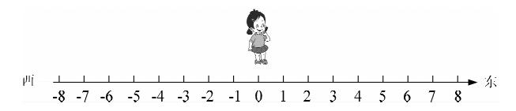

# Mathematics (Grade 6)

**ID**: 801f22e6
**难度**: hard
**题型**: fill_in_the_blank

## 题目
下图每一格表示1米，小玉开始所在的位置在0处。

1.如果小玉从0点向东行5米，表示+5米，那么从0点向西行3米，表示为（）米。
2.如果小玉现在所在的位置是+6米处，说明她是向（）行（）米。
3.如果小玉现在所在的位置是-8米，说明她是向（）行（）米。
4.如果小玉从0点先向西行6米，又向东行8米，这时小玉的位置表示为（）米。

## 解答

**答案**: -3, 东, 6, 西, 8, +2

1. Step1:根据规定向东记作正，向西记作负，小玉从0点向西行3米，所以表示为-3米
2. Step2:小玉所在位置是+6米处，因为向东记为正，所以说明她是向东行6米
3. Step3:小玉所在位置是-8米，由于向西记为负，所以说明她是向西行8米
4. Step4:小玉从0点先向西行6米记为-6米，又向东行8米记为+8米，-6 + 8 = +2米，所以这时小玉的位置表示为+2米

## 知识点

**知识点**:
  - 负数的认识

---
