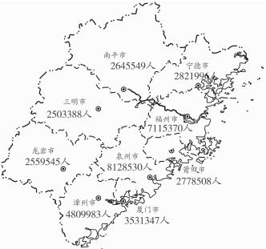

# Mathematics (Grade 6)

**ID**: 81618ee1
**难度**: hard
**题型**: fill_in_the_blank

## 题目
根据如图的福建省2010年第六次全国人口普查数据，回答相关问题。
（1）人口最多的是 $\underline{\hspace{5em}}$ 市，厦门市的人口排第 $\underline{\hspace{5em}}$ 位。
（2）人口在五百万以上的市有 $\underline{\hspace{5em}}$ 、 $\underline{\hspace{5em}}$ 。
（3）人口在二百多万的市有 $\underline{\hspace{5em}}$ 个。请把它们的人口按从大到小的顺序排列： $\underline{\hspace{5em}}$ 。

## 解答

**答案**: 泉州, 四, 泉州, 福州, 4, 2821996＞2645549＞2559545＞2503388

1. Step1:观察图中各城市人口数量，分别为泉州8128530人、福州7115370人、漳州4809983人、厦门3531347人、宁德2821996人、南平2645549人、龙岩2559545人、三明2503388人
2. Step2:将各城市人口数量进行从大到小排序，得到8128530＞7115370＞4809983＞3531347＞2821996＞2645549＞2559545＞2503388
3. Step3:根据排序结果，可知人口最多的城市是泉州，所以第一空答案为泉州
4. Step4:根据排序结果，厦门人口排第四，所以第二空答案为四
5. Step5:观察排序结果，人口在五百万以上的市是泉州和福州，所以第三、四空答案分别为泉州、福州
6. Step6:观察排序结果，人口在二百多万的市有宁德2821996人、南平2645549人、龙岩2559545人、三明2503388人，共4个，所以第五空答案为4
7. Step7:将二百多万人口的市的人口数量从大到小排列为2821996＞2645549＞2559545＞2503388，所以第六空答案为2821996＞2645549＞2559545＞2503388

## 知识点

**知识点**:
  - 万以上数的大小比较;万以上数的认识

---
