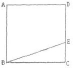

# Mathematics (Grade 6)

**ID**: 82d2ccf3
**难度**: hard
**题型**: fill_in_the_blank

## 题目
E是正方形ABCD的边CD上的三等分点（如图），BE把正方形分成一个梯形和一个三角形．梯形的周长比三角形的周长大8厘米．正方形ABCD的面积是$\underline{\hspace{5em}}$．

## 解答

**答案**: 36平方厘米

1. Step1:根据E是正方形ABCD的边CD上的三等分点，得出DC = 3EC
2. Step2:分析梯形和三角形的周长组成，得出梯形的周长 - 三角形的周长 = AB + DE - EC，又因为梯形的周长比三角形的周长大8厘米，所以AB + DE - EC = 8厘米
3. Step3:由于AB = DC = 3EC，DE = DC - EC = 3EC - EC = 2EC，将其代入AB + DE - EC = 8厘米，得到3EC + 2EC - EC = 8厘米，即4EC = 8厘米
4. Step4:由4EC = 8厘米，计算得出EC = 2厘米
5. Step5:根据DC = 3EC，算出DC = 3×2 = 6厘米
6. Step6:根据正方形面积公式，正方形ABCD的面积 = DC×DC = 6×6 = 36平方厘米

## 知识点

**知识点**:
  - 三角形面积与底的正比关系．

---
