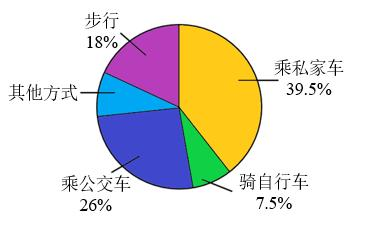

# Mathematics (Grade 6)

**ID**: 890170bb
**难度**: hard
**题型**: fill_in_the_blank

## 题目
某中学学生出行方式的统计情况如图所示，根据统计图完成下面各题。 

 （1）以其他方式出行的学生人数占全校总人数的（    ）%。
 （2）已知步行上学的有144人，则骑自行车上学的有多少人？

## 解答

**答案**: 9, 60

1. Step1:计算其他方式出行学生人数占比，用1减去步行、乘私家车、骑自行车、乘公交车出行人数占全校总人数的百分比，即1 - 18% - 39.5% - 7.5% - 26% = 9%
2. Step2:先根据步行人数和其占比求出全校总人数，用步行人数144除以步行人数占比18%，即144÷18% = 800人
3. Step3:计算骑自行车上学的人数，用全校总人数800乘骑自行车人数占比7.5%，即800×7.5% = 60人

## 知识点

**知识点**:
  - 

---
