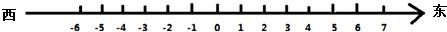

# Mathematics (Grade 6)

**ID**: 893e4316
**难度**: hard
**题型**: fill_in_the_blank

## 题目
看数轴回答问题．

（1）小明从0点出发，先向西走了6格，又向西走了5格，这时他的位置应记作$\underline{\hspace{5em}}$，如果他先向东走了7格，又向西走了4格，这时他的位置记作$\underline{\hspace{5em}}$．
（2）如果小明现在的位置在+6处，表示他从0向$\underline{\hspace{5em}}$走了$\underline{\hspace{5em}}$格．
（3）如果小明从0点出发先向东走了5格后，想回到-5的位置，他应向西走$\underline{\hspace{5em}}$格．

## 解答

**答案**: -11, 3, 东, 6, 10

1. Step1:根据向东为正，向西为负，计算小明先向西走6格又向西走5格的位置，0 - 6 - 5 = -11
2. Step2:计算小明先向东走7格又向西走4格的位置，7 - 4 = 3
3. Step3:因为位置是+6，根据向东为正，得出是从0向东走了6格
4. Step4:计算小明从0点出发先向东走5格后，要回到-5位置需向西走的格数，5 - (-5) = 10

## 知识点

**知识点**:
  - 正、负数的运算．

---
