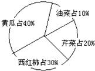

# Mathematics (Grade 6)

**ID**: 899bec15
**难度**: hard
**题型**: fill_in_the_blank

## 题目
一块600平方米的菜地，4种农作物的种植面积分布情况如图：
（1）这是一幅$\underline{\hspace{5em}}$统计图．
（2）黄瓜的种植面积是$\underline{\hspace{5em}}$，芹菜的种植面积是$\underline{\hspace{5em}}$，油菜的种植面积是黄瓜的（  ）

## 解答

**答案**: 扇形, 240平方米, 120平方米, 1/4

1. Step1:根据统计图的特征判断这是一幅扇形统计图
2. Step2:计算黄瓜的种植面积，因为总面积为600平方米，黄瓜占40%，所以600×40% = 240平方米
3. Step3:计算芹菜的种植面积，总面积为600平方米，芹菜占20%，则600×20% = 120平方米
4. Step4:计算油菜的种植面积，总面积为600平方米，油菜占10%，即600×10% = 60平方米，再计算油菜面积是黄瓜面积的几分之几，60÷240 = 1/4

## 知识点

**知识点**:
  - 扇形统计图；从统计图表中获取信息．

---
