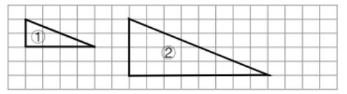

# Mathematics (Grade 6)

**ID**: 8bd59bd1
**难度**: hard
**题型**: fill_in_the_blank

## 题目
看图，填一填。

（1）图中的②号图形短直角边的长是①号图形长直角边的（）倍。
（2）①号图形长直角边的长是②号图形长直角边长的$\frac{（）}{（）}$。
（3）把①号图形按（）的比放大后得到②号图形。
（4）①号图形是②号图形按（）的比缩小后得到的。

## 解答

**答案**: 2, 1, 2, 1:2, 2:1

1. Step1:将一格的长度看作1，数出①号直角三角形较短直角边占2格，长度为2；②号直角三角形较短直角边占4格，长度为4，4÷2 = 2，所以图中的②号图形短直角边的长是①号图形短直角边长的2倍，得出（1）答案为2
2. Step2:数出①号直角三角形长直角边占4格，长度为4；②号直角三角形长直角边占8格，长度为8，4÷8 = 1/2，所以①号图形长直角边的长是②号图形长直角边长的1/2，得出（2）答案为1和2
3. Step3:因为①号图形短直角边为2，②号图形短直角边为4，4÷2 = 2，所以把①号图形按1:2的比放大后得到②号图形，得出（3）答案为1:2
4. Step4:由前面可知②号图形短直角边是①号图形短直角边的2倍，所以①号图形是②号图形按2:1的比缩小后得到的，得出（4）答案为2:1

## 知识点

**知识点**:
  - 图形的放大与缩小

---
