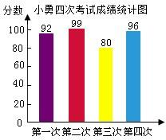

# Mathematics (Grade 6)

**ID**: 8c674547
**难度**: hard
**题型**: fill_in_the_blank

## 题目
看图回答问题：
（1）从图中得知，小勇最低的一次成绩比最高的一次成绩少$\underline{\hspace{5em}}$分．
（2）小勇第四次考试成绩比第三次提高了$\underline{\hspace{5em}}$%．
（3）这四次考试的平均成绩是$\underline{\hspace{5em}}$分，（精确到十分位）

## 解答

**答案**: 19, 20, 91.8

1. Step1:从图中可知第一次成绩为92分，第二次成绩为99分，第三次成绩为80分，第四次成绩为96分
2. Step2:计算小勇最低的一次成绩（80分）比最高的一次成绩（99分）少的分数，即99 - 80 = 19分
3. Step3:计算小勇第四次考试成绩比第三次提高的百分比，先算差值96 - 80 = 16分，再算提高的百分比16÷80 = 0.2 = 20%
4. Step4:计算这四次考试的平均成绩，先求和92 + 99 + 80 + 96 = 367分，再除以4，即367÷4≈91.8分

## 知识点

**知识点**:
  - 以一当五（或以上）的条形统计图；百分数的实际应用；平均数的含义及求平均数的方法．

---
