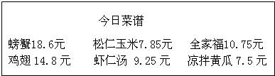

# Mathematics (Grade 6)

**ID**: 8dccd03e
**难度**: hard
**题型**: fill_in_the_blank

## 题目
请你买单．

菜单中，价格最贵的是______，最接近是______和______．
(1)买1份鸡翅和1份虾仁汤，需要多少元？
(2)小明有30元，买一份松仁玉米和1份鸡翅，够吗？
(3)小辉一家买了松仁玉米、鸡翅、螃蟹和全家福各一份．付出50元，找回2元．对吗？

## 解答

**答案**: 螃蟹, 松仁玉米, 凉拌黄瓜

1. Step1:比较各种菜的价格18.6、14.8、10.75、9.25、7.85、7.5，找出最大的数，可得价格最贵的是螃蟹
2. Step2:比较各种菜的价格18.6、14.8、10.75、9.25、7.85、7.5，找出最接近的两个数，可得最接近的是松仁玉米和凉拌黄瓜
3. Step3:计算买1份鸡翅和1份虾仁汤需要的钱数，用鸡翅的价钱14.8元加上虾仁汤的价钱9.25元，即14.8 + 9.25 = 24.05元
4. Step4:计算买一份松仁玉米和1份鸡翅的钱数和，用松仁玉米的价钱7.85元加上鸡翅的价钱14.8元，即7.85 + 14.8 = 22.65元，再与30元比较，30＞22.65
5. Step5:计算松仁玉米、鸡翅、螃蟹和全家福各买一份需要的总钱数，7.85 + 14.8 + 18.6 + 10.75 = 52元，与50元作差，52 - 50 = 2元，可知小辉还欠2元，而不是找回2元

## 知识点

**知识点**:
  - 整数、小数复合应用题;小数大小的比较．

---
