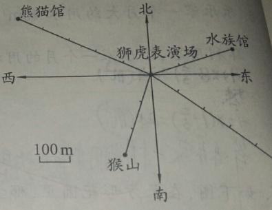

# Mathematics (Grade 6)

**ID**: 8ef4533c
**难度**: hard
**题型**: fill_in_the_blank

## 题目
以狮虎表演场为观测点：
 （1）熊猫馆在狮虎表演场的______偏
 ______ ______方向上，距离是______m.
 （2）猴山在狮虎表演场的______偏
 ______ ______方向上，距离是______m.
 （3）水族馆在狮虎表演场的______偏
 ______ ______方向上，距离是______m.
 （4）东东想从狮虎表演场去孔雀馆，应向
 ______偏______ ______方向走
 ______m，东东参观完孔雀馆想回到狮虎表演场，应向______偏______ ______方向走______m，如果每分钟走80m，那么从孔雀馆到狮虎表演场需______分钟.

## 解答

**答案**: 北, 西, 50°, 500, 南, 西, 30°, 300, 北, 东, 70°, 300, 东, 南, 42°, 600, 北, 西, 42°, 600, 7.5

1. Step1:根据地图‘上北下南，左西右东’方位，确定熊猫馆在狮虎表演场的北偏西方向，通过测量或观察得出角度为50°，根据比例尺确定距离为500m
2. Step2:根据地图方位，确定猴山在狮虎表演场的南偏西方向，通过测量或观察得出角度为30°，根据比例尺确定距离为300m
3. Step3:根据地图方位，确定水族馆在狮虎表演场的北偏东方向，通过测量或观察得出角度为70°，根据比例尺确定距离为300m
4. Step4:根据地图方位，确定从狮虎表演场去孔雀馆应向东偏南方向，通过测量或观察得出角度为42°，根据比例尺确定距离为600m
5. Step5:从孔雀馆回到狮虎表演场的方向与去时方向相反，角度不变，距离不变，所以应向北偏西42°方向走600m
6. Step6:根据公式时间=路程÷速度，路程为600m，速度为每分钟80m，计算得出从孔雀馆到狮虎表演场所需时间为600÷80 = 7.5分钟
7. Step7:将上述所有结果按顺序整理成列表

## 知识点

**知识点**:
  - --

---
