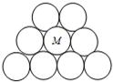

# Mathematics (Grade 6)

**ID**: 91696de1
**难度**: hard
**题型**: fill_in_the_blank

## 题目
有九张同样大小的圆形纸片，其中标有数码“1”的有1张；标有数码“2”的有2张；标有数码“3”的有3张，标有数码“4”的也有3张．把这九张圆形纸片如下图所示放置在一起，但标有相同数码的纸片不许靠在一起，问：
如果M位上放置标有数码“3”的纸片，一共有$\underline{\hspace{5em}}$种不同的放置方法．

## 解答

**答案**: 6

1. Step1:明确条件，有九张同样大小圆形纸片，标有数码‘1’的有1张，标有数码‘2’的有2张，标有数码‘3’的有3张，标有数码‘4’的有3张，且标有相同数码的纸片不许靠在一起
2. Step2:已知M位上放置标有数码‘3’的纸片，根据条件可知其余两个标有数码‘3’的纸片，只能放置在下面左右两边两个圆圈内
3. Step3:此时剩下两个标有数码‘2’的纸片、三个标有数码‘4’的纸片和一个标有数码‘1’的纸片，且穿插不许靠在一起，其排列次序一定
4. Step4:此时有六个空，因为其余纸片次序一定，所以只看‘1’的位置，得出‘1’有6种填法，即一共有6种不同的放置方法

## 知识点

**知识点**:
  - 简单的排列、组合．

---
