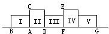

# Mathematics (Grade 6)

**ID**: 9509f6e7
**难度**: hard
**题型**: fill_in_the_blank

## 题目

(如图)一条直线上放着一个长方形Ⅰ，它的长与宽分别等于3厘米与4厘米，对角线恰好是5厘米，让这个长方形绕一个顶点A顺时针旋转90度后到了长方形Ⅱ的位置，此时B点到了C点的位置，如此连续做四次后，A点到了G点的位置，求A点所走过的总路程的长为______(圆周率按3计算)．

## 解答

**答案**: 18厘米

1. Step1:分析由Ⅰ到Ⅱ，A点是不动的，所以此过程A点走过的路程为0
2. Step2:分析由Ⅱ到 III，A点是以AD（长方形的宽4厘米）为半径走了90度，根据圆的周长公式C = 2πr，此过程A点走过的路程为2×3×4×(1/4)
3. Step3:分析由III 到 IV，A点是以长方形的对角线5厘米为半径走了90度，此过程A点走过的路程为2×3×5×(1/4)
4. Step4:分析由IV到 V，A点是以长方形的长3厘米为半径走了90度，此过程A点走过的路程为2×3×3×(1/4)
5. Step5:将上述四个过程A点走过的路程相加，即0 + 2×3×4×(1/4) + 2×3×5×(1/4) + 2×3×3×(1/4) = 18厘米，得到A点到G点走过的总路程

## 知识点

**知识点**:
  - 圆、圆环的周长．

---
