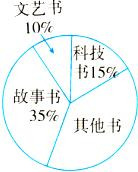

# Mathematics (Grade 6)

**ID**: 97b655c8
**难度**: hard
**题型**: fill_in_the_blank

## 题目
如图是某书店十月份图书销售情况统计图．已知卖出文艺书50本，那么卖出故事书$\underline{\hspace{5em}}$本、科技书$\underline{\hspace{5em}}$；这三种书卖出本数的中位数是$\underline{\hspace{5em}}$本．

## 解答

**答案**: 175, 75, 125

1. Step1:根据卖出文艺书50本和其占比10%，用除法计算出十月份图书销售总本数，即50÷10%=500本
2. Step2:用总本数500乘故事书占比35%，计算出卖出故事书的本数，即500×35%=175本
3. Step3:用总本数500乘科技书占比15%，计算出卖出科技书的本数，即500×15%=75本
4. Step4:将文艺书50本、故事书175本、科技书75本按从小到大顺序排列为50本、75本、175本
5. Step5:因为数据个数为3个，是奇数个，所以中位数就是中间的数75本，若数据个数为偶数个，中位数是中间两个数的平均数，这里将三种书卖出本数排序后，计算中间两个数75和175的平均数，即(75 + 175)÷2 = 125本

## 知识点

**知识点**:
  - 扇形统计图；百分数的实际应用．

---
