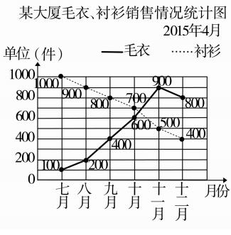

# Mathematics (Grade 6)

**ID**: 98429ed2
**难度**: hard
**题型**: fill_in_the_blank

## 题目
下图是某大厦毛衣、衬衫销售情况统计图，看图完成下面的问题。
1.毛衣在（）月销售量最大，是（）件，在（）月销售量最小，是（）件；衬衫在（）月销售量最大，是（）件，在（）月销售量最小，是（）件。
2.（）月毛衣销售量与衬衫销售量相差最大，相差（）件。
3.八月的毛衣销售量是衬衫的几分之几？
4.下半年平均每月的毛衣销售量是多少件？

## 解答

**答案**: 十一月, 900, 七月, 100, 七月, 1000, 十二月, 400, 七月, 900, 2/9, 500

1. Step1:观察统计图，找出毛衣销售量最大的月份为十一月，销售量是900件；销售量最小的月份为七月，销售量是100件。
2. Step2:观察统计图，找出衬衫销售量最大的月份为七月，销售量是1000件；销售量最小的月份为十二月，销售量是400件。
3. Step3:分别计算每个月毛衣与衬衫销售量的差值，七月差值为1000 - 100 = 900件，比较得出七月毛衣销售量与衬衫销售量相差最大，相差900件。
4. Step4:找到八月毛衣销售量为200件，衬衫销售量为900件，计算200÷900得出八月的毛衣销售量是衬衫的2/9。
5. Step5:将七月至十二月毛衣销售量相加，即100 + 200 + 400 + 600 + 900 + 800 = 3000件，再除以6，3000÷6 = 500件，得出下半年平均每月的毛衣销售量是500件。

## 知识点

**知识点**:
  - 从统计图表中获取信息;复式折线统计图

---
